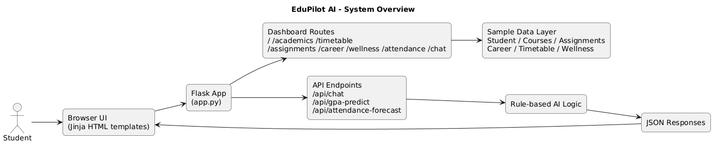
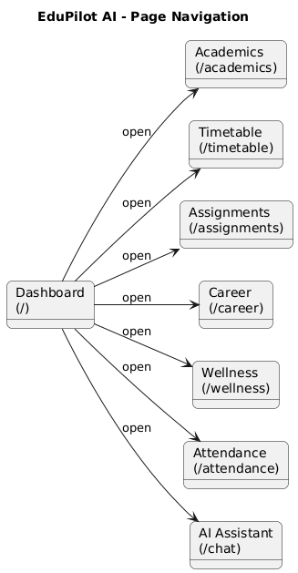
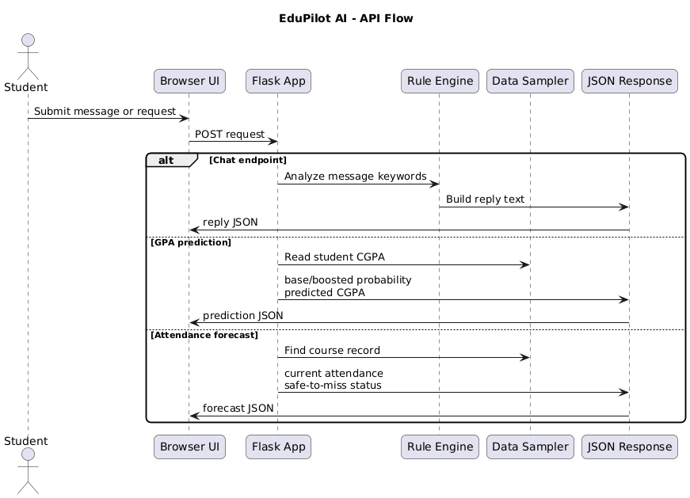
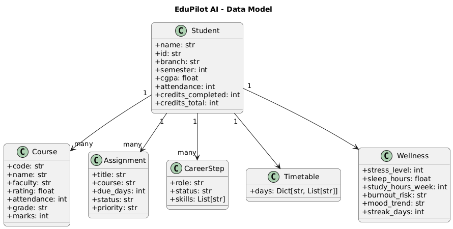

# EduPilot AI

EduPilot AI is a Flask-based student dashboard for academics, assignments, attendance, career planning, wellness tracking, and an AI campus assistant.

## Overview

This project demonstrates a full student success dashboard with multiple page views and simple API endpoints for predictions and chat responses. It uses sample data and Jinja templates stored in the project root.

## Architecture Diagrams

### System Overview



### Page Navigation



### API Flow



### Data Model



## Features

- Dashboard overview with CGPA, attendance, credits, assignments, and wellness snapshot
- Academic performance page with course grades and GPA prediction
- Attendance tracker with per-course forecasts
- Assignment planner with urgency-based timelines
- Career roadmap and skill-gap analysis
- Weekly timetable view
- Wellness monitor with mood trends and study-life balance tips
- AI assistant chat powered by a rule-based Flask API

## Tech Stack

- Python
- Flask
- Jinja2 templates
- HTML, CSS, and JavaScript

## Project Structure

- `app.py` - Flask application, sample data, routes, and API endpoints
- `*.html` - Jinja templates stored in the project root
- `requirements.txt` - Python dependency list

## Requirements

- Python 3.14+ recommended
- Flask

## Quick Start

Install dependencies:

```powershell
python -m pip install -r requirements.txt
```

Run the app:

```powershell
python app.py
```

Open the app in your browser:

```text
http://127.0.0.1:5000
```

## Available Pages

- `/` - Dashboard
- `/academics` - Academic performance
- `/timetable` - Weekly timetable
- `/assignments` - Assignment planner
- `/career` - Career navigator
- `/wellness` - Wellness monitor
- `/attendance` - Attendance predictor
- `/chat` - AI assistant

## API Endpoints

- `POST /api/chat` - Returns a rule-based assistant reply for a message payload
- `POST /api/gpa-predict` - Predicts CGPA impact from extra study hours
- `POST /api/attendance-forecast` - Forecasts attendance for a given course code

## Notes

- The templates live in the project root, so `app.py` is configured to load templates from the same folder.
- The app uses sample student data and is intended as a polished demo project.
# IITJAMMU
